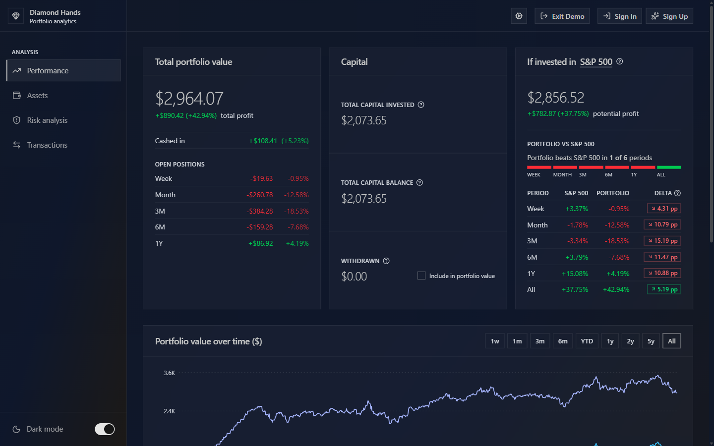
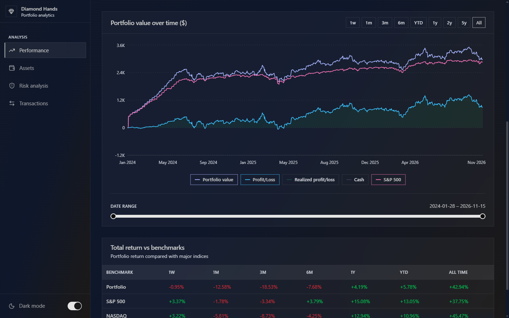
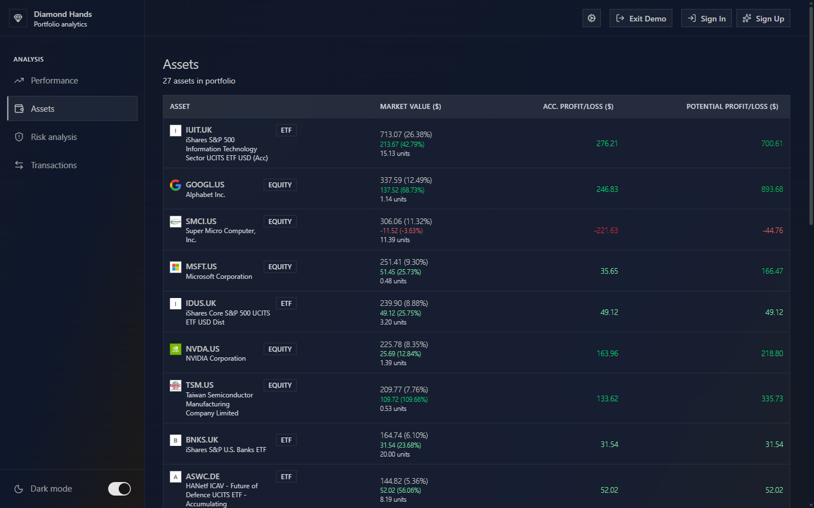
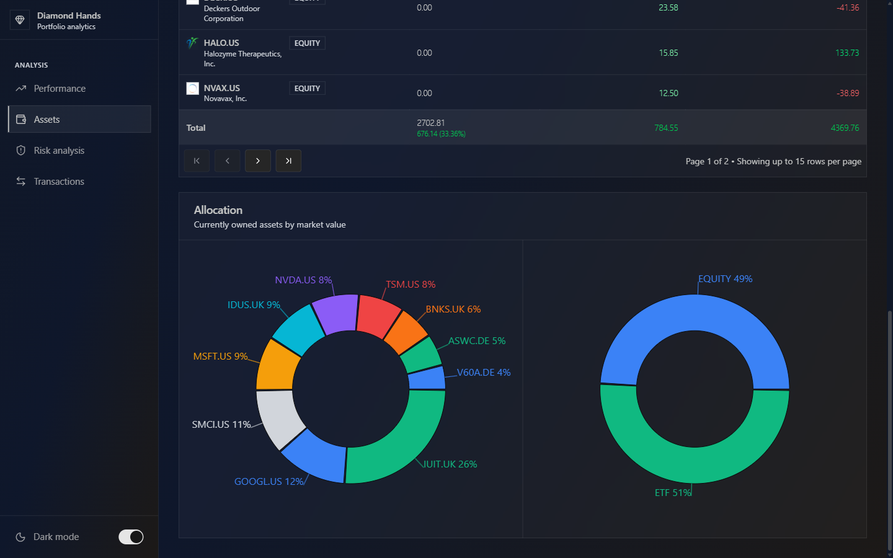
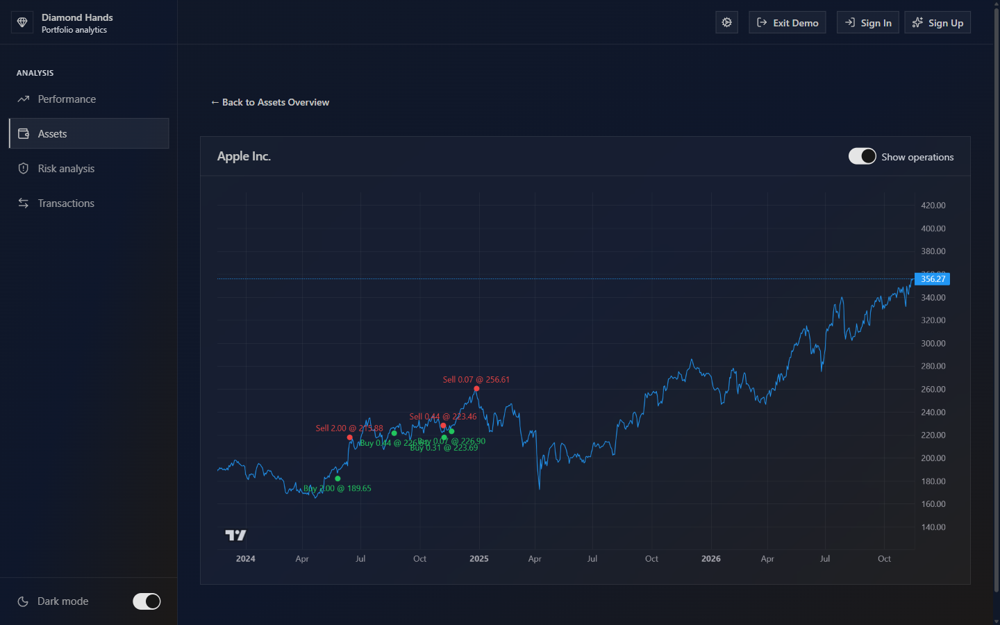
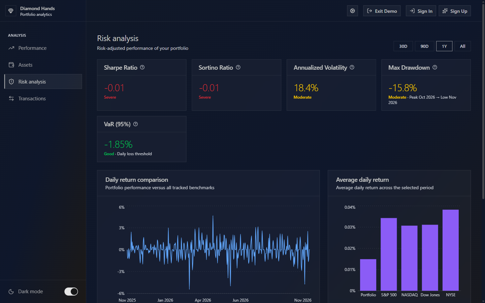
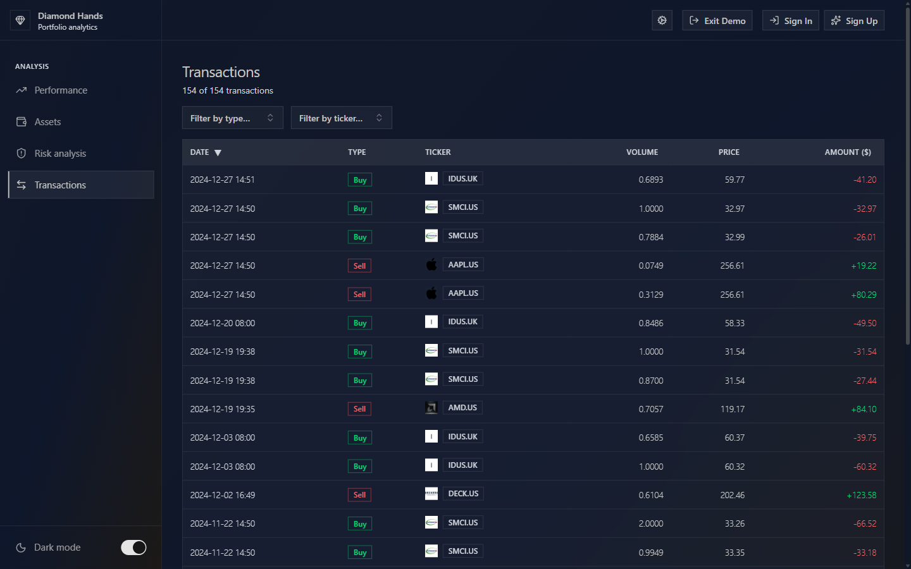
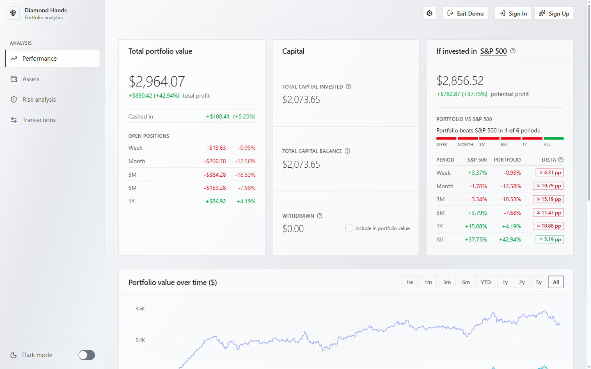

# 💎 Diamond Hands

**Portfolio analytics for XTB investors.** Upload your broker report and get performance, benchmark comparison, risk metrics and a full transaction history in seconds.

## ✨ Highlights

- **One-click import:** parses the `.xlsx` account statement exported from the XTB platform; uploading a newer report merges it with existing data.
- **Performance tracking:** portfolio value, accumulated and realised profit, open-position P/L by period, cash balance and withdrawals.
- **Three return metrics:** Simple Return, **Time-Weighted Return** and **Money-Weighted Return (IRR)**, switchable app-wide.
- **Benchmarking:** "what if I had invested in the index instead?", with period-by-period comparison against the **S&P 500, NASDAQ, Dow Jones and NYSE**.
- **Risk analysis:** Sharpe and Sortino ratios, annualised volatility, max drawdown, historical VaR (95%) and beta against each benchmark.
- **Asset drill-down:** per-asset price history (line or candlestick) with your buy/sell operations plotted on the chart.
- **Multi-currency:** USD and EUR portfolios, backed by historical exchange rates.
- **Demo mode:** explore the whole app with sample data, no account required.

## 📸 Features

### Performance

Portfolio value over time, with the benchmark overlaid and total return compared across indices.

### Assets

Every position with market value, allocation, accumulated and potential profit/loss, plus an allocation breakdown by asset and instrument type.

### Asset details

### Risk analysis

### Transactions

Filterable, sortable history of buys, sells, deposits and withdrawals.

### Light and dark

<table>
  <tr>
    <td></td>
    <td></td>
  </tr>
</table>

## 🛠️ Engineering highlights

- **Heavy computation off the main thread:** the portfolio analysis (daily timeline, returns, risk metrics) runs in a **Web Worker** with request cancellation, so the UI stays responsive on large histories.
- **Lean API payloads:** the user's portfolio events and the market data are served by separate endpoints. Market data comes in one bulk request in a compact, columnar, close-only format (as-traded prices are derived on the client from the splits), and full candles are fetched only when an asset chart is opened. For the 31-ticker demo portfolio, market data went from ~10 MB to ~1.2 MB (~250 KB gzipped).
- **Layered caching:** market data is cached in **Redis** (refreshed hourly); exchange rates are cached per currency pair and 365-day window, with past windows kept for good, so the rates API is called at most hourly. User data is persisted in **Appwrite**, and parsed portfolios are cached client-side in **IndexedDB**. Server state is managed with **TanStack Query**.
- **Financial maths implemented from scratch:** TWR and IRR-based MWR, Sharpe/Sortino, drawdown, historical VaR and beta, all unit-tested with **Vitest**.
- **Corporate actions handled:** historical prices are adjusted for **stock splits** fetched from Yahoo Finance.
- **Dependency injection** with **Inversify** for server-side clients (database, Redis), keeping them swappable and testable.
- **Design system** built on Radix UI primitives and Tailwind CSS 4 design tokens (flat outlined surfaces, a shared card system, theme-aware charts).
- **Production concerns:** authentication with **Clerk**, error monitoring with **Sentry**, analytics with **Vercel Analytics**.

## 🧰 Tech stack

| Area           | Tools                                                                                 |
| -------------- | ------------------------------------------------------------------------------------- |
| Framework      | Next.js 15 (App Router, Turbopack), React 19, TypeScript                              |
| UI             | Tailwind CSS 4, Radix UI, lucide-react, GSAP                                          |
| Data & state   | TanStack Query, TanStack Table, Zustand, IndexedDB (`idb`)                            |
| Charts         | Recharts, TradingView Lightweight Charts                                              |
| Backend & data | Next.js route handlers, Appwrite, Redis, Inversify                                    |
| External APIs  | Yahoo Finance (prices and splits), Frankfurter (ECB exchange rates), logo.dev (logos) |
| Auth & ops     | Clerk, Sentry, Vercel Analytics                                                       |
| Quality        | Vitest, ESLint, Prettier                                                              |
